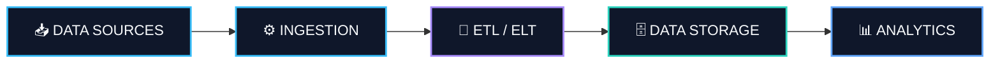

<!-- ═══════════════════════════════════════════════════════ -->
<!--                 MEHDI ROSTAMI · README                 -->
<!--                  DATA ENGINEERING                      -->
<!-- ═══════════════════════════════════════════════════════ -->

<div align="center">


<br/>

<a href="https://www.linkedin.com/in/mehdi-rostami-8b7a49266">
  
</a>
<a href="https://t.me/mhdirst">
  
</a>
<a href="mailto:mehdirost4mi@gmail.com">
  
</a>

<br/><br/>


</div>

<br/>

<!-- ═══════════════════════════════════════════════════════ -->
<!--                    SYSTEM PROFILE                     -->
<!-- ═══════════════════════════════════════════════════════ -->

## <code>01.</code> 🧬 SYSTEM PROFILE

```bash
mehdi@data-engineering:~$ whoami

  Name       : Mehdi Rostami
  Role       : Data Engineer
  Focus      : Data Pipelines & Automation
  Interests  : Data Systems | Analytics | Infrastructure
  Philosophy : Automate what repeats. Engineer what matters.

mehdi@data-engineering:~$ cat about.txt

  I enjoy building reliable data systems that transform
  messy, scattered information into clean, structured,
  and meaningful datasets.

  My interests revolve around Data Engineering,
  pipeline architecture, automation, and creating
  efficient workflows that make data genuinely useful.

mehdi@data-engineering:~$ echo $STATUS

  [ ACTIVE ]  Always learning. Always building.
```

<br/>

<!-- ═══════════════════════════════════════════════════════ -->
<!--                      TECH STACK                       -->
<!-- ═══════════════════════════════════════════════════════ -->

## <code>02.</code> ⚡ TECH ARSENAL

<div align="center">

<sub>THE TECHNOLOGIES I WORK WITH</sub>

<br/><br/>

<table>
<tr>
<td width="50%" valign="top">

### ◈ Data & Analytics


</td>

<td width="50%" valign="top">

### ◈ Programming & Development


</td>
</tr>

<tr>
<td width="50%" valign="top">

### ◈ Engineering & Infrastructure


</td>

<td width="50%" valign="top">

### ◈ Web & Scraping


</td>
</tr>
</table>

</div>

<br/>

<!-- ═══════════════════════════════════════════════════════ -->
<!--                 DATA ENGINEERING FLOW                 -->
<!-- ═══════════════════════════════════════════════════════ -->

## <code>03.</code> 🔷 HOW I THINK ABOUT DATA

<div align="center">

*From raw information to reliable, actionable insights.*

</div>



<br/>

<!-- ═══════════════════════════════════════════════════════ -->
<!--                    CURRENT FOCUS                      -->
<!-- ═══════════════════════════════════════════════════════ -->

## <code>04.</code> 🚀 CURRENTLY LEVELING UP

<div align="center">


</div>

<br/>

<table>
<tr>
<td width="33%" align="center">

### 🔄 ETL / ELT

**Pipeline Engineering**

Data modeling, reliable workflows, and building robust data pipelines.

</td>
<td width="33%" align="center">

### 🌪️ Apache Airflow

**Workflow Orchestration**

Scheduling, managing, and monitoring automated workflows.

</td>
<td width="33%" align="center">

### ⚡ PySpark

**Distributed Processing**

Exploring scalable data processing and large-scale transformations.

</td>
</tr>
</table>

<br/>

<!-- ═══════════════════════════════════════════════════════ -->
<!--                       PHILOSOPHY                      -->
<!-- ═══════════════════════════════════════════════════════ -->

<div align="center">

### ✦ MY ENGINEERING PHILOSOPHY

> **"Reliable pipelines. Clean datasets. Smarter decisions."**

<br/>

`BUILD` · `AUTOMATE` · `OPTIMIZE` · `REPEAT`

<br/>


</div>
