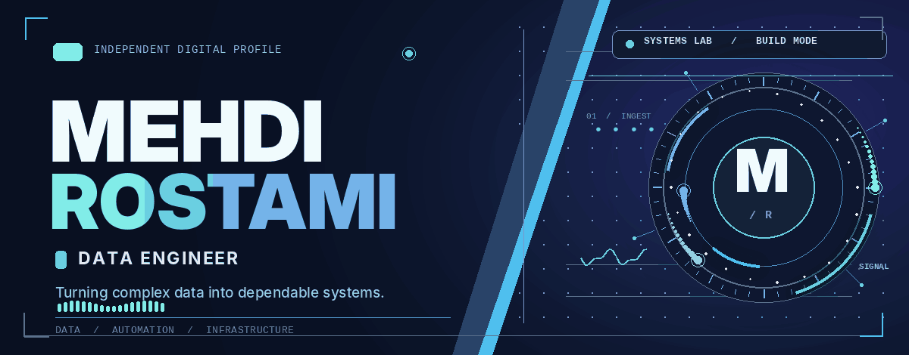
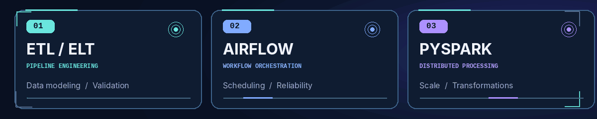

<!--
  MEHDI ROSTAMI — GITHUB PROFILE
  Edition: SYSTEMS / V2
  All custom animated artwork is stored locally in ./assets.
  No remote animation services, trackers, scripts, or GitHub username assumptions.
-->

  

 

  &nbsp;
  &nbsp;
  

 

### <samp>01 / THE PERSON BEHIND THE PIPELINES</samp>

**I build the infrastructure behind useful data.**

I'm **Mehdi Rostami**, a **Data Engineer** interested in building dependable pipelines, clean data models, and automation that turns fragmented information into something teams can actually use. I enjoy working at the intersection of **software engineering, data, and infrastructure** — where reliability matters as much as the result.

 

### <samp>02 / TOOLCHAIN</samp>

<table width="100%">
  <tr>
    <td width="50%" valign="top">
      
<strong>01 — DATA &amp; ANALYTICS</strong>

      

        
        
        
        
        
        
      

    </td>
    <td width="50%" valign="top">
      
<strong>02 — SOFTWARE &amp; SYSTEMS</strong>

      

        
        
        
        
      

    </td>
  </tr>
  <tr>
    <td width="50%" valign="top">
      
<strong>03 — INFRASTRUCTURE</strong>

      

        
        
        
        
        
      

    </td>
    <td width="50%" valign="top">
      
<strong>04 — WEB &amp; AUTOMATION</strong>

      

        
        
        
        
        
      

    </td>
  </tr>
</table>

 

### <samp>03 / CURRENTLY LEVELING UP</samp>

Exploring more of **ETL / ELT architecture**, **Apache Airflow**, and **PySpark** — with a focus on scalable, production-minded data workflows.

   
  

 

### <samp>04 / ENGINEERING PRINCIPLES</samp>

  <h3>Design for reliability. Automate with purpose. Make data trustworthy.</h3>
   
  

